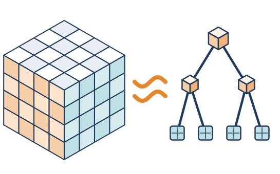
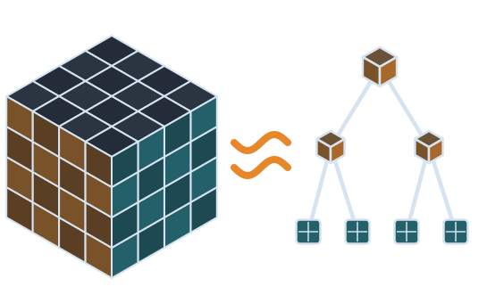

# tensap

```{raw} html
<div class="tensap-hero">
  <div class="tensap-hero__main">
    
    
    <p class="tensap-hero__tagline">Tensor Approximation Package</p>
    <p class="tensap-hero__text">
      Low-rank tensor formats to approximate and learn high-dimensional
      functions and operators.
    </p>
    <p class="tensap-hero__buttons">
      <a class="tensap-button tensap-button--primary" href="getting_started/index.html">Getting Started</a>
      <a class="tensap-button" href="theory/index.html">Theory &amp; Methods</a>
    </p>
  </div>
  <div class="tensap-hero__picture">
    
    
  </div>
</div>
```


## Documentation

::::{grid} 1 2 3 3
:gutter: 2
:class-container: tensap-cards tensap-cards--sections

:::{grid-item-card} {octicon}`rocket;1.4em` Getting Started
:link: getting_started/index
:link-type: doc

Install tensap and run a first computation.
:::

:::{grid-item-card} {octicon}`mortar-board;1.4em` Theory & Methods
:link: theory/index
:link-type: doc

Concepts, notations and algorithms.
:::

:::{grid-item-card} {octicon}`code;1.4em` API Reference
:link: api/index
:link-type: doc

Every class and function.
:::

:::{grid-item-card} {octicon}`git-pull-request;1.4em` Contributing
:link: contributing/index
:link-type: doc

Build the docs, add an example, propose a change.
:::

::::

```{toctree}
:hidden:
:maxdepth: 2

getting_started/index
theory/index
api/index
contributing/index
bibliography
```
